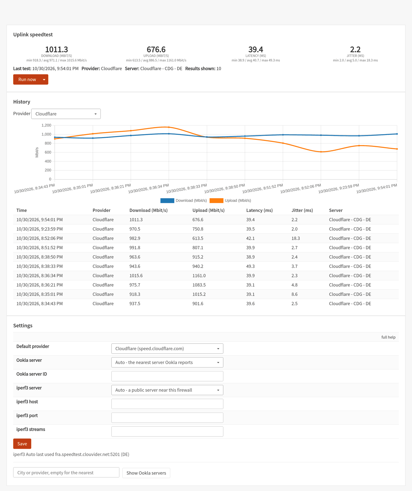
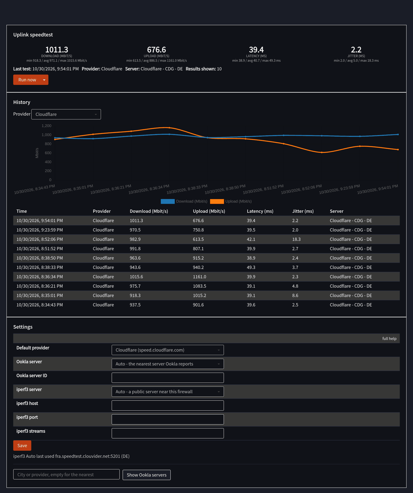
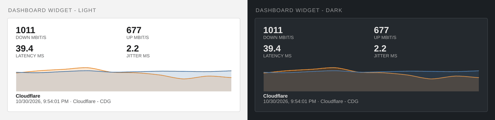
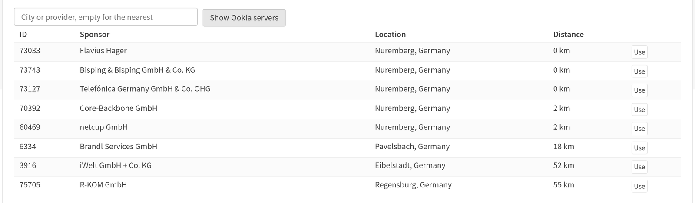

# os-uplink-speedtest

Measure the uplink of an OPNsense firewall on a schedule, and keep the answer on the
firewall itself: a **Reporting → Speedtest** page, a **dashboard widget**, and a cron job
you set to whatever hours suit you.

Three engines — **Cloudflare** (the default, no extra package), **Ookla** and **iperf3** —
so you can check one against another instead of trusting a single number.



<details>
<summary>The same page in the dark theme</summary>


</details>



## What you get

* **Reporting → Speedtest** — latest download, upload, latency and jitter with min/avg/max
  over the window shown, a chart, a history table with a provider filter, **Run now** (and
  a dropdown to run one specific provider), and a lookup of the Ookla servers near you.
* **A dashboard widget** — the latest four numbers of your default provider, a sparkline of
  its last 20 results, and the time and server of the last run. Light and dark, because it
  is built on the core widget base class.
* **A cron job** — "Run uplink speedtest" appears under **System → Settings → Cron**, so the
  schedule is yours. Three runs a day is a sensible start.
* **History on the box** — `/var/db/uplink-speedtest/history.json`, the last 1000 results,
  written atomically and kept across a reinstall. Nothing is uploaded anywhere.

## Providers

Every result records which provider produced it, and the chart, the sparkline and the widget
each show one provider at a time: mixing them would compare three different things.

| Provider | Engine | How it measures | Server choice | Reports |
| --- | --- | --- | --- | --- |
| **Cloudflare** (default) | Python standard library only | HTTPS to `speed.cloudflare.com`, download in 8 MB chunks, upload counted on acknowledgement; latency and jitter from 20 small requests | n/a — Cloudflare routes you to its nearest PoP | the PoP it was served from, e.g. `CDG` |
| **Ookla** | `py313-speedtest-cli` | the speedtest.net protocol, run in-process | **Auto**: the nearest servers from Ookla's live API, lowest latency wins. **Custom**: a server ID you pin, from the search box or typed in | server id, sponsor, city, country |
| **iperf3** | `iperf3` | raw TCP, `-R` for download then forward for upload, 4 streams by default | **Auto**: your country from Cloudflare's trace endpoint, then a built-in list of verified public servers for that region and its neighbours. **Custom**: your own host and port | `host:port` |

Auto and Custom are an explicit choice per provider, so switching back to Auto keeps the
server you had typed.



**Data per run:** Cloudflare moves roughly 0.7 GB per direction (a 2 s ramp plus a 4 s timed
window, capped at 700 MB and 25 s either way) and iperf3 about the same over its 6 s per
direction. On a gigabit line that is a few seconds of traffic; on a metered uplink it is
not free, which is part of why three runs a day is plenty.

## Requirements

* **OPNsense 26.1 or 26.4** on FreeBSD 14 (amd64). Both tested; the code uses only MVC and
  dashboard APIs that exist in each.
* `py313-speedtest-cli` and `iperf3`, both from the official OPNsense package repository —
  `install.sh` pulls them in as dependencies. **No binaries are downloaded from anywhere
  else**, and the default provider needs neither of them.
* Root on the firewall, and a machine that can `scp` to it.

## Install

OPNsense ships no `git`, so build the checkout into a package on the firewall:

```sh
tar -czf /tmp/uplink-speedtest.tgz --exclude=.git opnsense-uplink-speedtest
scp /tmp/uplink-speedtest.tgz <user>@<firewall>:/tmp/
ssh <user>@<firewall> 'mkdir -p /tmp/ust && tar -xzf /tmp/uplink-speedtest.tgz -C /tmp/ust \
    && cd /tmp/ust/opnsense-uplink-speedtest && sudo ./install.sh'
```

`install.sh` installs the two engine packages if they are missing, builds `src/` into a real
`os-uplink-speedtest` package and `pkg add`s it, so pkg owns every file:
`pkg info -l os-uplink-speedtest` lists them and uninstalling takes exactly those away.

Then add the cron job: **System → Settings → Cron → +**, command **Run uplink speedtest**,
minutes `0`, hours `6,12,18`. And add the widget: **Dashboard → Add widget → Speedtest**.

### Upgrade

Run `install.sh` from the newer checkout. Settings and history are kept.

If an earlier release is installed under a *different package name*, `install.sh` finds it,
carries its settings, cron schedule, page privilege, dashboard placement and measurement
history across, and removes the old package. Those edits go through OPNsense's own config
API, so the previous `config.xml` is restorable from **System → Configuration → Backups**.

### Uninstall

```sh
pkg delete os-uplink-speedtest    # keeps the measurement history
rm -rf /var/db/uplink-speedtest   # and this drops the history too
```

`./uninstall.sh` does the first line, `./uninstall.sh --purge` both.

### Building inside the official plugins tree

`src/` and the `Makefile` follow the `opnsense/plugins` layout: copy this directory to
`plugins/net/uplink-speedtest` in a plugins checkout and run `make package`.

## Configuration

Everything lives at the bottom of **Reporting → Speedtest**:

| Setting | Meaning |
| --- | --- |
| Default provider | what **Run now** and the cron job use, and what the widget shows |
| Ookla server | Auto (nearest) or Custom (the ID below) |
| Ookla server ID | a pinned server; the search box fills it in for you |
| iperf3 server | Auto (by location) or Custom (the host below) |
| iperf3 host / port / streams | empty means port 5201 and 4 streams |

The cron job always runs the default provider; the cron dropdown offers one command, not one
per provider. To measure with another engine, use the **Run now** dropdown on the page, or
`configctl uplinkspeedtest runwith <provider>` from a job of your own.

## How it works

| Piece | Path |
| --- | --- |
| Engine | `/usr/local/opnsense/scripts/OPNsense/UplinkSpeedtest/uplink_speedtest.py` (`run [provider]`, `servers [search]`, `selftest`) |
| Cloudflare provider | `.../UplinkSpeedtest/uplink_cloudflare.py`, standard library only |
| configd actions | `/usr/local/opnsense/service/conf/actions.d/actions_uplinkspeedtest.conf` |
| API | `/api/uplink_speedtest/service/{run,status,history,providers,servers}`, `/api/uplink_speedtest/settings/{get,set}` |
| Page | `/ui/uplink_speedtest` |
| Widget | `/usr/local/opnsense/www/js/widgets/UplinkSpeedtest.js` + `Metadata/UplinkSpeedtest.xml` |
| History and state | `/var/db/uplink-speedtest/{history,state}.json` |

Only one test runs at a time: the configd action is wrapped in `flock -n`, so a second
trigger exits rather than competing for the uplink. **Run now** starts the test detached and
the page polls `service/status`, so a slow test can never time out a web request. configd
passes the provider name as an argument, never through a shell.

Two commands worth knowing on the box:

```sh
configctl uplinkspeedtest selftest        # built-in checks, no traffic
configctl uplinkspeedtest runwith ookla   # one named provider
```

## Troubleshooting

**The page does not open, or OPNsense shows its crash reporter.** Look at
`/var/lib/php/tmp/PHP_errors.log` — that is where a template or controller error lands. Send
it with the issue; it names the file and line.

**No results appear.** Run `configctl uplinkspeedtest run` on the box and read what it
prints; it reports the failure instead of writing a record. `configctl uplinkspeedtest
selftest` checks the internals without touching the network.

**Cloudflare results stop or look odd.** `speed.cloudflare.com` answers **429 from exactly
10,000,000 bytes per request upward** and 403 from 100 MB, which is why the download runs in
8 MB chunks. Its latency is an HTTPS round trip, not ICMP (the host does not answer ping), so
it reads a little above the network RTT — consistently, which is what a trend needs.

**Ookla picks a server in the wrong country.** `speedtest-cli` ships a static server list that
is years stale, and ranks it by your WAN IP's geolocation. This plugin asks Ookla's own live
API instead, which places you from the request itself, and hands the chosen entry to the
engine — so a current server is both listed and measurable. If the API cannot be reached the
page says so and falls back to the static list. A hand-typed ID that has never been listed
cannot be resolved: search for it once and it is remembered.

**iperf3 says the server is busy.** Public iperf3 servers take one test at a time. Auto walks
a list of verified servers for your region, so a busy one costs you the next candidate. If a
whole region stays silent the run fails with `no reachable iperf3 server for <country>`
rather than hanging. Pin your own server under Custom if you have one.

**Ookla or iperf3 numbers are lower than your line.** Both are CPU-bound on the firewall;
see below.

## Known limits

* **On a fast uplink you measure the firewall, not the line.** `speedtest-cli` is pure Python
  and iperf3 runs on the same CPU, so above roughly a gigabit the figure is the box's ceiling.
  Cloudflare is the most honest of the three on this hardware, which is why it is the default.
* **Ookla jitter is ours, not Ookla's.** `speedtest-cli` reports none, so the plugin uses ICMP
  round-trip stddev to the chosen server, and `null` when the server does not answer ping. It
  also prints a sentinel in the millions of milliseconds when its own latency probe fails;
  anything above 10 s is replaced by that ICMP round trip.
* **A 0 bit/s result is refused.** Some Ookla servers are listed under a hostname their TLS
  certificate does not cover and the engine swallows the failure, reporting zero with a
  plausible latency. The plugin connects to the name the certificate is issued for and
  discards a zero rather than recording it.
* The history table and chart show the most recent 50 results of the selected provider; the
  file keeps 1000 across all providers.
* Results written by 1.0 carry no provider field and are read as Ookla, which is what they were.

## Privacy

The measurement, the history and the UI stay on the firewall. Nothing is sent to the author
of this plugin, there is no telemetry, and no result is shared with Ookla (`--share` is never
used).

What does leave the box, and to whom:

| To | When | What they see |
| --- | --- | --- |
| `speed.cloudflare.com` (Cloudflare) | every Cloudflare run | your IP, and the bytes transferred |
| `speed.cloudflare.com/cdn-cgi/trace` | iperf3 on Auto | your IP; the answer is your country and PoP |
| `www.speedtest.net/api/js/servers` (Ookla) | opening the server list, and every Ookla run on Auto | your IP, which is how it places you |
| the chosen Ookla server (run by an ISP or a hosting company) | every Ookla run | your IP, and the bytes transferred |
| the chosen iperf3 server | every iperf3 run | your IP, and the bytes transferred |

Pick **iperf3 with a Custom server you control** if you would rather no third party saw the
traffic at all.

## Contributing

See [CONTRIBUTING.md](CONTRIBUTING.md). Bug reports want your OPNsense version and
`/var/lib/php/tmp/PHP_errors.log`; the issue template asks for both.

Security reports: [SECURITY.md](SECURITY.md).

## Licence

BSD 2-Clause — see [LICENSE](LICENSE).

The idea of a speedtest plugin for OPNsense comes from
[mihakralj/opnsense-speedtest](https://github.com/mihakralj/opnsense-speedtest) (last code
2021, old-style PHP dashboard widget that 26.x no longer renders, no licence file). This
plugin was written from scratch for OPNsense 26.x; none of that project's code, files or
assets are used here.
